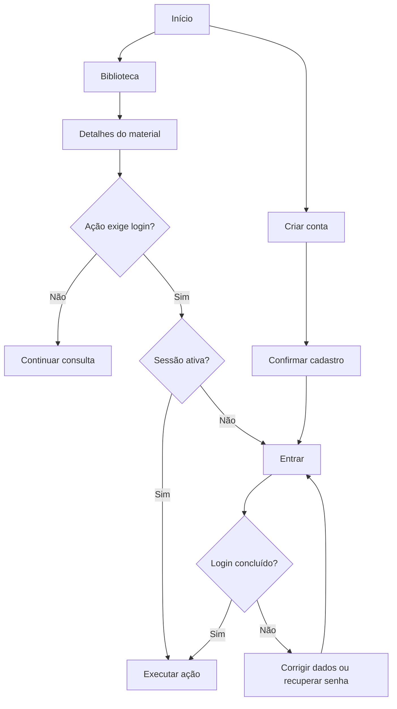
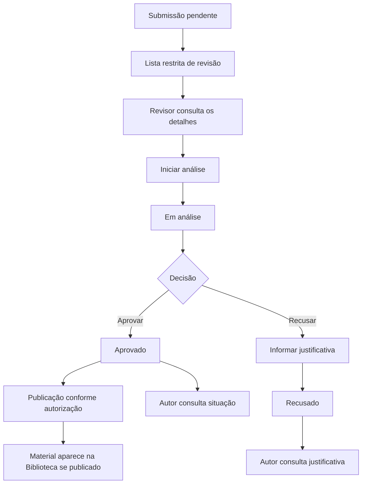

# EduComp — User Flow

**Versão:** 0.8  
**Atualizado em:** 07/11/2026  
**Situação:** fluxos planejados; ainda não implementados ou validados com usuários.

## 1. Visão geral

Este documento descreve os caminhos principais de quem utiliza o EduComp: descobrir materiais, acessar arquivos, guardar favoritos, enviar contribuições e acompanhar sua revisão.

**Início, Biblioteca e detalhes são públicos.** Abrir arquivos, salvar materiais, enviar contribuições e acessar o perfil exige login. A revisão é reservada às contas autorizadas.

Os fluxos tomam como referência o [protótipo desktop no Figma](https://www.figma.com/design/r8Lo2AKMd0UglgA8RRDl1y/EduComp?node-id=4437-32520). A disposição das telas poderá mudar no tablet e no celular, mas as ações e os caminhos de recuperação deverão continuar disponíveis.

## 2. Entrada e autenticação

O visitante pode explorar a Biblioteca e ler os detalhes sem se cadastrar. Se tentar abrir um arquivo ou salvar um material, será encaminhado ao login. Depois de entrar, deverá retomar a ação interrompida; se tiver iniciado o login diretamente, irá para a Biblioteca.

- **Cadastro:** aceita e-mails pessoais e institucionais. Após a conclusão, o próximo passo é o login, respeitando a eventual verificação de e-mail exigida pelo serviço de autenticação.
- **Login:** credenciais incorretas apresentam erro sem iniciar a sessão.
- **Recuperação de senha:** o usuário solicita um link por e-mail, redefine a senha e volta ao login. Links inválidos ou expirados devem permitir uma nova solicitação.
- **Saída:** a opção Sair encerra a sessão. Operações pessoais voltam a exigir login.

Contas comuns não recebem permissão de revisão automaticamente. O papel de revisor será concedido manualmente e verificado também no servidor.

## 3. Descoberta na Biblioteca

O visitante ou professor acessa a Biblioteca, visualiza os materiais publicados e pode abrir seus detalhes. A listagem começa pelos **mais recentes**, com opção de ordenação alfabética por título e **12 materiais por página**.

### Pesquisa

1. A pessoa digita um título ou palavras-chave e pressiona **Enter** ou seleciona **Buscar**.
2. O sistema consulta apenas materiais publicados, considerando título e tags. A busca ignora diferenças de caixa e acentos, aceita trechos de palavras e exige correspondência de todos os termos digitados.
3. A Biblioteca apresenta os resultados e a quantidade total encontrada, ou informa que não houve correspondências.
4. Uma nova pesquisa mantém os filtros aplicados e volta à primeira página.

A consulta não é executada automaticamente a cada tecla. Se uma pesquisa anterior terminar depois de uma mais recente, seus resultados não devem substituir a listagem atual.

### Filtros

Os filtros são **Tipo de material**, **Etapa de ensino** e **Eixo da Computação**. É possível selecionar várias opções em cada categoria: vale **OU** dentro dela e **E** entre categorias diferentes e a pesquisa textual.

| Ação | Resultado |
| --- | --- |
| Abrir uma categoria | Exibe as opções já aplicadas. |
| Marcar ou desmarcar | Altera apenas a seleção temporária. |
| Aplicar | Confirma a categoria, atualiza os resultados e retorna à primeira página. |
| Limpar | Desmarca apenas a categoria aberta; os resultados não mudam até Aplicar. |
| Fechar sem Aplicar | Descarta as mudanças temporárias e mantém a consulta anterior. |

Opções sem materiais correspondentes continuam visíveis e selecionáveis. Se a combinação não encontrar nenhum material, a interface mostra o estado vazio da pesquisa.

### Paginação e retorno

Pesquisa, filtros, ordenação e página atual serão preservados na **URL**. Ao abrir os detalhes e voltar, a pessoa encontra a consulta anterior; a posição da rolagem também deverá ser restaurada quando tecnicamente viável.

A Biblioteca distingue carregamento, acervo sem materiais, pesquisa sem resultados e falha de consulta. Em caso de falha, oferece nova tentativa quando possível.

## 4. Detalhes e acesso aos arquivos

Os detalhes podem ser abertos pela Biblioteca ou pela área Salvos. Apresentam as informações cadastradas, incluindo palavras-chave, classificações, autoria ou fonte e os arquivos associados. Campos opcionais vazios não recebem conteúdo fictício.

Para abrir um arquivo:

1. A pessoa seleciona um dos arquivos listados no material.
2. Se não estiver autenticada, entra na conta e retoma a tentativa de acesso.
3. O sistema verifica a autorização e disponibiliza o arquivo, quando possível.
4. Se houver indisponibilidade ou falta de permissão, a interface informa o problema sem apresentar um acesso inexistente.

Um material pode conter **vários arquivos**. Links externos e visualização integrada não fazem parte do MVP. O acesso público aos detalhes não permite contornar a autenticação exigida para obter os arquivos.

Ao voltar, a pessoa retorna à Biblioteca com seus critérios preservados ou à coleção Salvos, conforme a origem.

## 5. Materiais salvos

O professor autenticado pode adicionar ou remover um favorito pela Biblioteca ou pelos detalhes. Depois de cada operação, o estado visual deve refletir o que foi efetivamente salvo.

Na área **Salvos**, o professor encontra sua coleção pessoal, pode abrir os detalhes e remover itens. Os favoritos permanecem associados à conta entre sessões, sem duplicar o mesmo material.

Se a coleção estiver vazia, a interface informa isso. Falhas ao carregar, salvar ou remover não devem aparecer como operações concluídas. **Salvos não terá pesquisa nem filtros próprios** nesta versão.

## 6. Envio e acompanhamento

O professor autenticado acessa **Enviar material**, preenche o formulário e anexa os arquivos. **Enviar material** e **Meus envios** são duas abas da mesma área.

O formulário deve permitir palavras-chave livres e seleção múltipla de tipos, etapas e eixos. Quando houver Ensino Fundamental ou Médio, será obrigatório informar os anos ou séries correspondentes. São aceitos arquivos PDF, DOCX, PPTX, PNG e JPG, com até **20 MB por arquivo** e possibilidade de anexar vários arquivos.

O percurso é:

1. Preencher os campos, informar autoria ou fonte e confirmar o direito de compartilhar o conteúdo.
2. Selecionar os arquivos e enviar.
3. Corrigir campos ou arquivos inválidos, caso a validação indique algum problema.
4. Após a confirmação do sistema, receber a mensagem de envio concluído e um atalho para **Meus envios**.
5. Consultar a situação da submissão na aba de acompanhamento.

O envio concluído fica **Pendente** e não é publicado automaticamente. O autor não pode alterar uma submissão enviada no MVP. Se ela for recusada, uma nova tentativa exigirá outra submissão.

Em **Meus envios**, o professor visualiza somente os próprios materiais e sua situação atual: **Pendente, Em análise, Aprovado ou Recusado**. Uma recusa exibe a justificativa. Não haverá notificações por e-mail nem central de notificações.

## 7. Revisão e publicação

A área de revisão será acessível somente a pessoas autorizadas. Ela terá uma lista de submissões, os detalhes do material e os controles necessários para iniciar a análise, aprovar ou recusar.

O revisor verifica o preenchimento, a classificação, os arquivos, a autoria e as condições de uso declaradas. **Abrir os detalhes não inicia a análise:** essa mudança exige uma ação explícita.

A recusa exige uma justificativa breve, que ficará disponível ao autor. O MVP manterá a situação atual da submissão e a justificativa de recusa, sem histórico completo das transições.

**Aprovação e publicação são condições distintas.** Um responsável autorizado pode retirar um material da Biblioteca sem transformar sua situação editorial em Recusado. Edição de materiais já publicados e despublicação também dependem de autorização.

A interface de revisão ainda precisa ser desenhada no Figma. Não é necessário criar um painel administrativo completo para esse fluxo.

## 8. Perfil e compartilhamento

### Meu perfil

Após entrar, o professor pode abrir **Meu perfil**, consultar seus dados e alterar **nome, foto e senha**. O e-mail será exibido, mas não poderá ser editado. Uma atualização só deve ser confirmada depois de salva; erros permitem corrigir os dados ou tentar novamente.

### Copiar link

A ação de compartilhamento do MVP copia **o endereço da página inicial do EduComp**, mesmo quando estiver disponível em outro contexto. O texto da ação precisa informar claramente esse destino, sem sugerir que será copiado o link de um material específico.

Após a tentativa de cópia, a interface informa sucesso ou falha. O compartilhamento direto por redes sociais fica fora do MVP.

## 9. Navegação, erros e acessibilidade

Menus, filtros e diálogos devem permitir fechamento por **Escape**, com controle do foco e retorno ao elemento que abriu a sobreposição, conforme o componente. Fechar um filtro sem Aplicar não altera os resultados.

| Situação | Caminho de continuidade |
| --- | --- |
| Ação protegida sem login | Entrar e retomar a tarefa. |
| Login inválido ou link de recuperação expirado | Corrigir os dados ou solicitar outro link. |
| Pesquisa sem resultados | Revisar texto ou filtros, sem perder o contexto. |
| Falha ao carregar materiais | Informar o erro e permitir nova tentativa. |
| Arquivo indisponível ou não autorizado | Informar a restrição e manter o acesso aos detalhes. |
| Erro no envio | Apontar o problema e preservar os dados recuperáveis. |
| Falha ao aprovar ou recusar | Não apresentar decisão como concluída; permitir nova tentativa quando cabível. |

As jornadas precisam funcionar com teclado, foco visível e mensagens compreensíveis. A mesma lógica de navegação será mantida nas versões para tablet e celular, mesmo que os menus e formulários sejam reorganizados.

## 10. Ajustes necessários no Figma

- [ ] Adicionar palavras-chave, classificações múltiplas e seleção de anos/séries no formulário de envio.
- [ ] Representar o upload de vários arquivos e seus estados de validação.
- [ ] Desenhar a lista e os detalhes da revisão, com início de análise, aprovação e recusa justificada.
- [ ] Revisar o rótulo e a posição da ação que copia o endereço da página inicial.
- [ ] Conferir os caminhos de retorno, os estados de erro e a navegação nas versões responsivas.

As decisões sobre quantidade máxima de arquivos, regras específicas de ano/série e detalhes técnicos de autenticação serão fechadas antes de implementar os respectivos fluxos.

## 11. Rastreabilidade

| Jornada | Histórias de usuário | Requisitos |
| --- | --- | --- |
| Entrada e autenticação | US-018, US-014 a US-016 | RF-020, RF-015 a RF-017 |
| Biblioteca e filtros | US-001 a US-003 | RF-001 a RF-005 |
| Detalhes e arquivos | US-004, US-006 a US-008 | RF-006, RF-008 a RF-010 |
| Salvos | US-010 | RF-012 |
| Envio e acompanhamento | US-009, US-013 | RF-011, RF-019 |
| Revisão e publicação | US-012 | RF-014 |
| Perfil | US-017 | RF-018 |
| Compartilhamento | US-011 | RF-013 |

A **US-005 / RF-007**, referente a links externos, está reservada para uma versão futura.

## 12. Documentos relacionados

- [Escopo do MVP](../product/escopo-mvp.md)
- [Requisitos](../product/requisitos.md)
- [Histórias de usuário](../product/historias-de-usuario.md)
- [Especificação de busca e filtros](../product/especificacao-busca-filtros.md)
- [Especificação de metadados](../product/especificacao-metadados.md)
- [Arquitetura da Informação](arquitetura-da-informacao.md)
- [Handoff de UI/UX](handoff.md)
