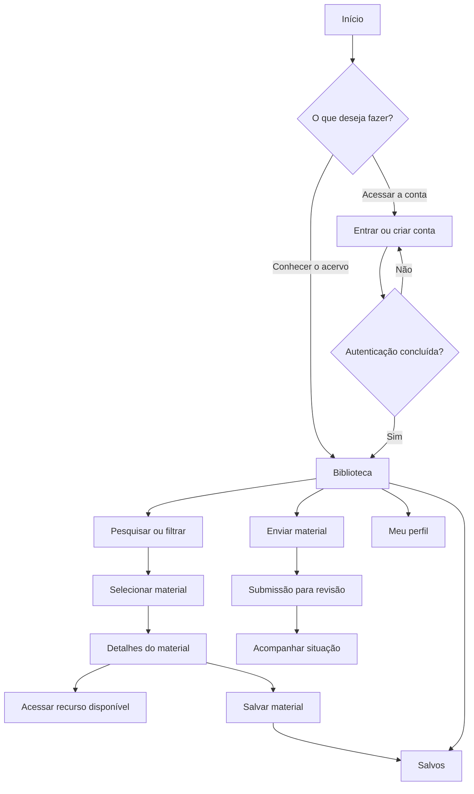
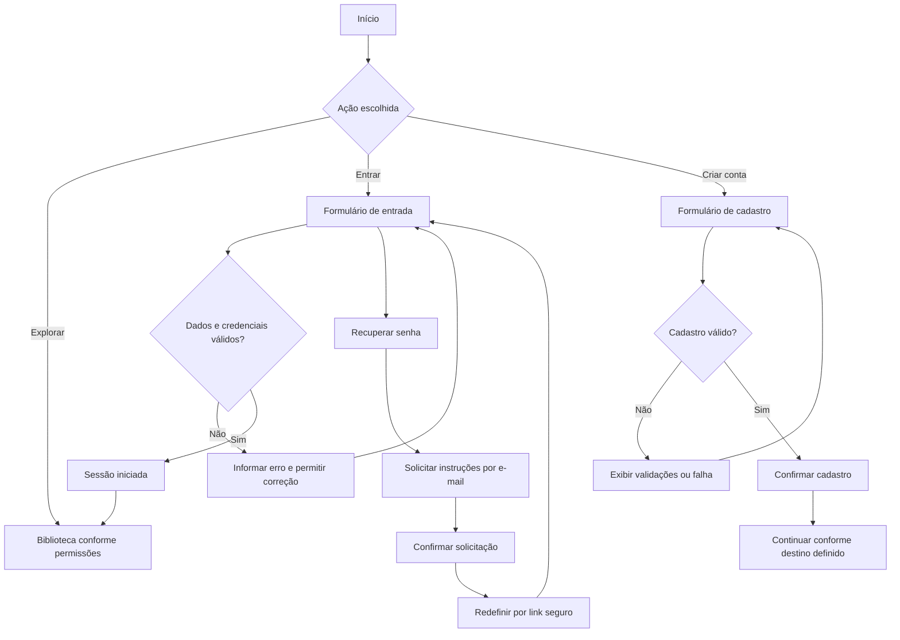
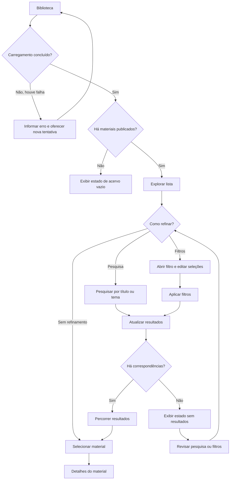
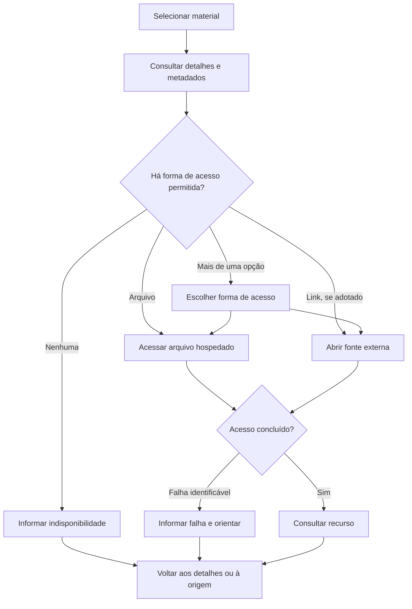
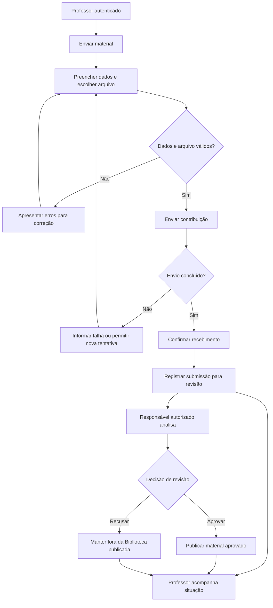

# EduComp — User Flow

**Versão:** 0.6  
**Data:** 04/11/2026  
**Situação:** Fluxos de experiência planejados para o MVP; implementação e validação com usuários não iniciadas.

## 1. Objetivo

Mapear os percursos que permitem a professores conhecer o EduComp, acessar sua conta, encontrar materiais pedagógicos de Computação, consultar recursos, manter favoritos e enviar contribuições para revisão.

O documento descreve **ações, decisões, respostas da interface, desvios e pontos de retorno**. Não define telas adicionais como concluídas, contratos de API nem regras técnicas de armazenamento. O comportamento de detalhes funcionais permanece nas especificações e nos requisitos.

## 2. Pessoas e condições de acesso

| Pessoa ou papel | Objetivo no fluxo | Condição de acesso |
|---|---|---|
| **Visitante** | Conhecer a plataforma e encontrar caminhos de entrada | Pode acessar Início e telas de autenticação; acesso à Biblioteca e aos detalhes ainda depende de definição. |
| **Professor autenticado** | Descobrir, consultar, salvar e enviar materiais; administrar o perfil | Necessita de sessão válida para ações pessoais e de contribuição. |
| **Responsável pela revisão** | Avaliar submissões e decidir sobre a publicação | Exige permissão específica; o acesso e a interface de moderação ainda serão definidos. |

Quando uma pessoa tentar executar uma ação protegida, a experiência deverá informar a necessidade de autenticação ou a falta de permissão, sem executar a ação indevidamente. O retorno à tarefa original após entrar na conta permanece pendente de decisão.

## 3. Visão geral das jornadas

O mapa apresenta conexões lógicas entre as jornadas; não pressupõe que todas as áreas sejam páginas independentes. Menus, filtros e perfil podem ser apresentados em sobreposições. O alcance da navegação para visitantes ainda precisa ser confirmado.

## 4. Jornada de entrada e autenticação

### 4.1. Entrada e cadastro

**Percurso esperado:**

1. A pessoa chega ao **Início** e escolhe explorar, entrar ou criar uma conta.
2. Em **Entrar**, informa e-mail e senha; dados inválidos ou falhas mantêm a possibilidade de corrigir e tentar novamente.
3. Com credenciais válidas, a sessão é iniciada e a pessoa segue para a **Biblioteca**, que é o destino de referência para a entrada.
4. Em **Criar conta**, informa nome, e-mail e senha; o sistema valida os campos, evita duplicidade e confirma o cadastro concluído.
5. Em **Recuperar senha**, informa o e-mail, recebe feedback da solicitação e poderá redefinir a senha por link seguro.
6. As telas de acesso oferecem retorno à entrada ou ao Início, conforme o contexto.

**Alternativas e limites:** a autenticação real, o envio de e-mail e a redefinição por link serão implementados posteriormente. A exigência de e-mail institucional, os destinos após cadastro e recuperação e o redirecionamento de quem iniciou uma ação protegida precisam de definição. A opção de continuar com Google não integra o MVP.

### 4.2. Saída da conta

1. O professor abre o **Menu do perfil**.
2. Seleciona **Sair da plataforma**.
3. O sistema encerra a sessão.
4. O usuário retorna ao **Início**; operações pessoais passam a exigir nova autenticação.

Fechar o menu sem selecionar **Sair** não encerra a sessão.

## 5. Jornada de descoberta na Biblioteca

### 5.1. Exploração e pesquisa

O professor pode explorar os materiais publicados sem preencher a pesquisa. Também pode informar palavras-chave por **título e tema**. A pesquisa e os filtros devem funcionar em conjunto, preservando os critérios aplicados quando um deles for alterado.

Uma consulta pode apresentar materiais, nenhuma correspondência, carregamento ou falha. **Acervo vazio** significa ausência de materiais publicados; **sem resultados** significa que os critérios atuais não encontraram correspondências. Os dois estados devem ser distintos.

A listagem deve oferecer paginação ou carregamento progressivo, ainda a escolher. O retorno dos detalhes à Biblioteca deve manter o termo pesquisado e os filtros aplicados durante a navegação; a preservação exata da rolagem após retorno ou recarregamento ainda precisa ser definida.

### 5.2. Seleção e aplicação dos filtros

Há três grupos: **Tipo de material**, **Etapa de ensino** e **Eixo da Computação**. Cada grupo é aberto em uma sobreposição com seleção múltipla.

1. O professor abre um dos grupos e visualiza as seleções já aplicadas.
2. Marca ou desmarca opções, modificando temporariamente a seleção daquele grupo.
3. Seleciona **Aplicar** para atualizar os resultados da Biblioteca.
4. Pode reabrir qualquer grupo e conferir o que continua aplicado.
5. A opção **Limpar** deve permitir retirar seleções, mas seu alcance e o momento da confirmação ainda serão definidos.

As opções do mesmo grupo combinam-se por **OU**; grupos diferentes e a pesquisa textual combinam-se por **E**. Fechar a sobreposição sem aplicar não deve produzir uma alteração não intencional nos resultados; o destino das seleções temporárias ainda precisa ser formalizado.

## 6. Jornada de detalhes e acesso ao recurso

1. Ao selecionar um material na **Biblioteca** ou em **Salvos**, o professor abre os **Detalhes do material**.
2. Consulta título, descrição, classificações e demais informações disponíveis.
3. Identifica a ação para acessar o arquivo associado ao material. Caso links externos sejam admitidos, eles devem ser diferenciados dos arquivos hospedados.
4. Quando não houver recurso acessível ou houver falta de permissão, a interface comunica a condição sem apresentar ações inexistentes.
5. Após consultar ou tentar acessar o conteúdo, o professor pode retornar aos detalhes ou à área de origem.

A plataforma deve comunicar apenas falhas que consiga identificar. Não deve afirmar que um site externo está indisponível sem conseguir verificar essa condição. A pré-visualização integrada de arquivos não faz parte do MVP.

### 6.1. Favoritar nos detalhes ou na listagem

Se a pessoa estiver autenticada, pode marcar ou desmarcar um material como favorito. A interface deve refletir a alteração e a lista pessoal deve permanecer atualizada entre sessões. Caso a ação esteja disponível visualmente para visitantes, ela deverá solicitar autenticação antes de modificar favoritos.

### 6.2. Compartilhamento básico

Ao abrir **Compartilhar** ou **Copiar link**, a pessoa seleciona a ação de cópia e recebe confirmação ou mensagem de falha. O destino do link — plataforma, material ou ambos — ainda será definido. Os canais sociais desenhados na interface não integram o fluxo funcional do MVP.

## 7. Jornada de materiais salvos

1. O professor autenticado favorita um material na **Biblioteca** ou nos **Detalhes**.
2. O sistema registra o favorito vinculado à conta e atualiza o estado da ação.
3. O professor abre **Salvos** e consulta a lista pessoal.
4. Pode abrir os detalhes de um item ou removê-lo dos favoritos.
5. A lista é atualizada após a remoção e apresenta um estado vazio quando não há materiais salvos.
6. Ao voltar dos detalhes, o professor retorna ao contexto de **Salvos**, sem precisar refazer a descoberta.

Falhas ao salvar, carregar ou remover materiais devem ser comunicadas sem apresentar uma alteração como concluída quando não foi persistida. A relação entre usuário e material não deve gerar duplicidade de favoritos.

## 8. Jornada de envio, acompanhamento e revisão

### 8.1. Envio pelo professor

O professor abre **Enviar material**, preenche os metadados requeridos e seleciona um arquivo. O sistema valida os dados, apresenta mensagens para correção e informa o andamento do upload. Em caso de sucesso, confirma o recebimento e registra a submissão, **sem publicá-la automaticamente**.

Os formatos aceitos, limites, campos obrigatórios e condições de uso dos materiais ainda precisam de definição.

### 8.2. Acompanhamento

O professor deve conseguir identificar seus envios e a situação de cada submissão. Os estados propostos são **Pendente**, **Em análise**, **Aprovado** e **Recusado**. A localização dessa consulta na navegação ainda não foi definida; o fluxo não presume que já exista uma tela específica.

### 8.3. Revisão autorizada

Um responsável com permissão adequada acessa as submissões, consulta os dados necessários e registra aprovação ou recusa. Somente materiais aprovados podem aparecer na Biblioteca publicada. Critérios de decisão, transições de status, justificativa de recusa, eventual reenvio e interface de moderação ainda dependem de especificação.

## 9. Jornada de perfil

1. O professor autenticado abre o **Menu do perfil**.
2. Seleciona **Meu perfil**, que pode ser exibido como sobreposição.
3. Consulta os dados registrados e escolhe editar informações pessoais, alterar foto ou senha.
4. O sistema valida as alterações antes de salvá-las.
5. Após uma operação concluída, informa sucesso e apresenta os dados atualizados; se houver falha, comunica o problema e permite corrigir ou tentar novamente.
6. Ao fechar o perfil, o professor retorna ao contexto de onde o abriu, quando aplicável.

A alteração não deve ser apresentada como concluída antes de ser persistida. O acesso ao perfil de outra pessoa não é permitido sem autorização.

## 10. Menus, sobreposições e recursos complementares

| Elemento | Entrada e saída esperadas | Observação |
|---|---|---|
| **Menu da Biblioteca** | Aberto pela navegação contextual; conduz a destinos disponíveis e deve permitir fechamento. | Não representa uma página de conteúdo. |
| **Menu de Salvos** | Oferece navegação a partir da área de favoritos e permite voltar à lista. | Variações compacta e completa devem ter fechamento coerente. |
| **Menu do perfil** | Aberto pela opção de perfil; permite acessar Meu perfil, sair ou fechar. | Fechar não equivale a sair da conta. |
| **Filtros** | Abertos a partir da Biblioteca; permitem seleção, Aplicar, Limpar e fechamento. | Seleções temporárias e aplicadas precisam permanecer distinguíveis. |
| **Compartilhar** | Aberto no contexto disponível; permite copiar o link ou fechar. | Integrações sociais ficam para evolução posterior. |
| **Notificações** | Há uma sobreposição prevista na experiência visual. | Histórico, ações de leitura e contador não integram o MVP. |

As sobreposições devem possuir controles de fechamento identificáveis, gerenciamento de foco e comportamento consistente por teclado. A forma de fechamento por clique fora ou tecla Esc e sua aplicação nos dispositivos menores precisam de revisão.

## 11. Estados alternativos e recuperação

| Situação | Resposta esperada | Continuidade possível |
|---|---|---|
| **Credenciais inválidas** | Informar que não foi possível entrar, sem iniciar sessão. | Corrigir os dados ou recuperar senha. |
| **Cadastro inválido ou e-mail duplicado** | Identificar o problema sem declarar sucesso. | Corrigir campos ou usar a entrada. |
| **Biblioteca vazia** | Informar ausência de materiais publicados. | Retornar ao Início ou consultar novamente depois. |
| **Busca sem correspondência** | Informar que não há resultados para os critérios atuais. | Revisar pesquisa ou filtros. |
| **Falha no carregamento** | Distinguir erro técnico de lista vazia. | Tentar novamente quando possível. |
| **Material sem recurso acessível** | Informar ausência de acesso permitido. | Voltar aos detalhes ou à listagem. |
| **Falha ao favoritar** | Informar que a ação não foi concluída. | Tentar novamente sem criar estado enganoso. |
| **Erro de upload** | Informar falha e preservar dados recuperáveis do formulário. | Corrigir ou reenviar. |
| **Falha ao atualizar perfil** | Informar que os dados não foram salvos. | Corrigir ou tentar novamente. |
| **Ação sem permissão** | Impedir a operação e comunicar a restrição. | Entrar com conta autorizada ou voltar. |

O fluxo deve evitar saídas sem orientação, mas não promete recuperação automática em situações que dependam de serviços externos ou de decisões técnicas futuras.

## 12. Decisões de UX ainda necessárias

| Tema | Decisão pendente |
|---|---|
| **Acesso como visitante** | Definir se Biblioteca e Detalhes podem ser consultados sem entrar. |
| **Continuidade da autenticação** | Confirmar o destino após cadastro e recuperação e o retorno à tarefa que exigiu login. |
| **Pesquisa** | Definir quando a consulta é executada e como a ordenação é apresentada. |
| **Filtros** | Definir fechamento sem Aplicar, alcance de Limpar e comportamento de opções sem resultados. |
| **Resultados** | Escolher paginação ou carregamento progressivo; definir preservação de rolagem e estado ao retornar. |
| **Arquivos e links** | Confirmar formas de acesso, apresentação das opções e mensagens de indisponibilidade. |
| **Compartilhamento** | Definir destino do link copiado e os contextos em que a ação aparece. |
| **Envios** | Definir a localização do acompanhamento e o que é exibido para cada situação. |
| **Moderação** | Definir entrada, organização da interface e passos da decisão autorizada. |
| **Responsividade** | Revisar menus, formulários e sobreposições para telas menores. |

## 13. Verificação futura dos fluxos

Antes da implementação, os percursos deverão ser conferidos no protótipo navegável, especialmente os caminhos de retorno e fechamento das sobreposições. Durante o desenvolvimento e o QA, poderão ser verificados cenários de sucesso, erro, indisponibilidade e falta de permissão. Posteriormente, testes com professores poderão avaliar a compreensão e a facilidade de execução das jornadas.

Não foram realizadas validações completas dos fluxos em modo de apresentação nem pesquisas com usuários reais. Os diagramas representam **comportamentos pretendidos**, não funcionalidades implementadas.

## 14. Documentos relacionados

- [`../product/escopo-mvp.md`](../product/escopo-mvp.md) — funcionalidades e limites da primeira versão.
- [`../product/requisitos.md`](../product/requisitos.md) — requisitos e regras de negócio.
- [`../product/historias-de-usuario.md`](../product/historias-de-usuario.md) — critérios de aceitação das tarefas.
- [`../product/especificacao-busca-filtros.md`](../product/especificacao-busca-filtros.md) — comportamento de pesquisa e filtros.
- [`../product/especificacao-metadados.md`](../product/especificacao-metadados.md) — dados dos materiais e submissões.
- [`arquitetura-da-informacao.md`](arquitetura-da-informacao.md) — organização dos destinos e conteúdos.
- [`objetivos-de-ux.md`](objetivos-de-ux.md) — objetivos de experiência.
- [`design-system.md`](design-system.md) — padrões visuais e estados de componentes.
