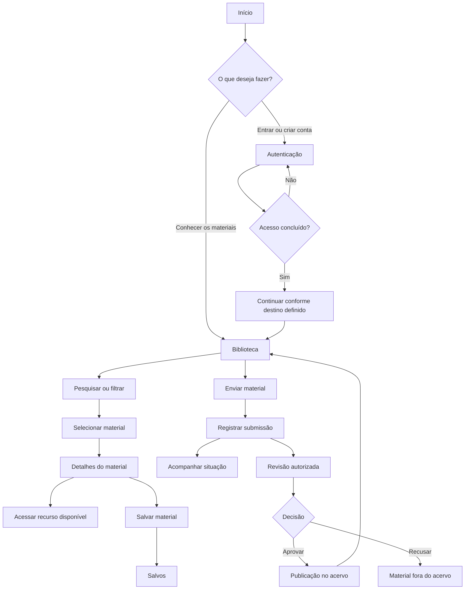
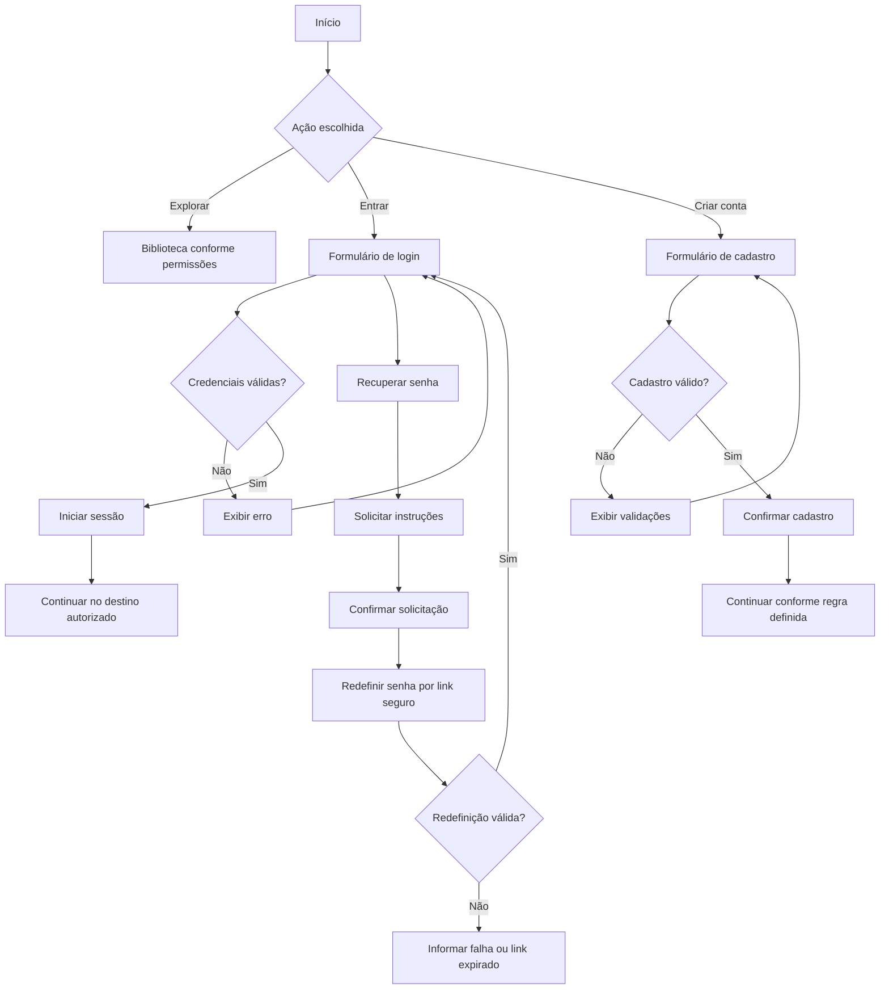
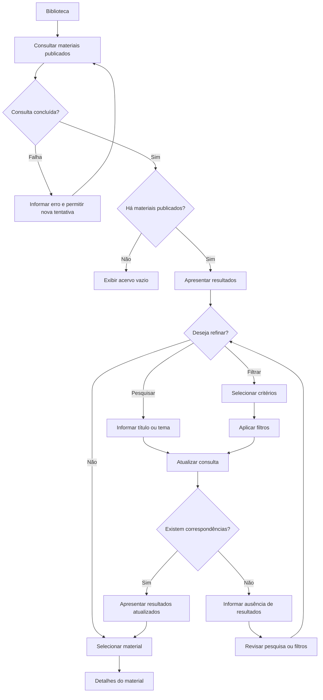
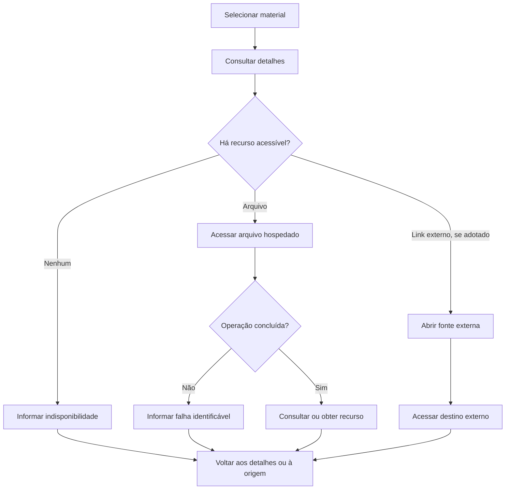
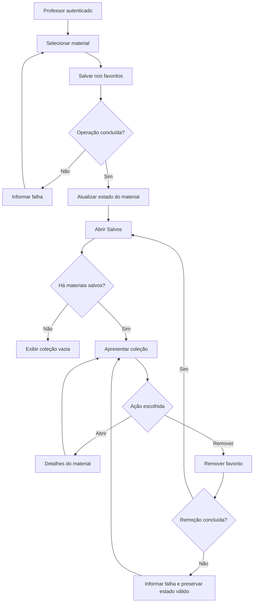
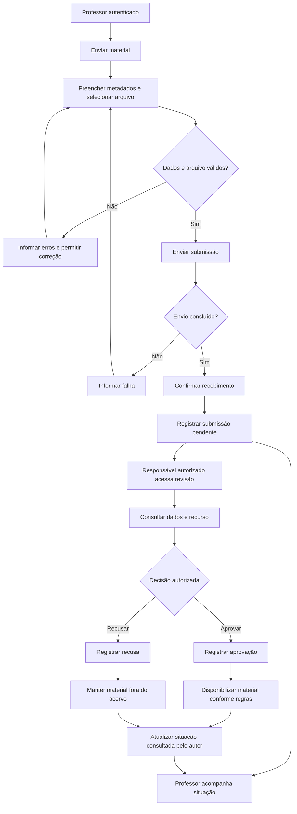

# EduComp — User Flow

**Versão:** 0.7  
**Data:** 07/11/2026  
**Situação:** fluxos planejados para o MVP; desenvolvimento e validação com usuários não iniciados.

## 1. Objetivo

Este documento descreve os principais percursos de utilização do EduComp, desde o primeiro contato com a plataforma até a descoberta, consulta, organização e contribuição de materiais pedagógicos.

Os fluxos representam as ações do usuário, as decisões necessárias, as respostas da interface e os caminhos de continuidade ou recuperação.

O objetivo é orientar a implementação e a verificação da experiência, mantendo coerência entre as necessidades dos professores, os requisitos funcionais e a navegação definida no projeto.

O documento não estabelece rotas técnicas, contratos de API ou estruturas de armazenamento. Essas decisões serão tomadas durante a preparação do desenvolvimento.

### 1.1. Referências

- [Protótipo desktop — Figma](https://www.figma.com/design/r8Lo2AKMd0UglgA8RRDl1y/EduComp?node-id=4437-32520)
- [Escopo do MVP](../product/escopo-mvp.md)
- [Requisitos](../product/requisitos.md)
- [Histórias de usuário](../product/historias-de-usuario.md)
- [Arquitetura da Informação](arquitetura-da-informacao.md)
- [Handoff de UI/UX](handoff.md)

### 1.2. Limites dos fluxos

Os percursos descritos correspondem às funcionalidades previstas para o MVP.

O Figma apresenta experiências adicionais, como login com Google, notificações e participação na comunidade. Essas funcionalidades não são tratadas como etapas obrigatórias dos fluxos atuais.

A implementação começará pelo desktop. As adaptações para tablet e dispositivos móveis deverão preservar as jornadas e comportamentos funcionais definidos, respeitando as particularidades de cada interface.

Os diagramas representam comportamentos planejados, não funcionalidades já implementadas ou validadas.

## 2. Pessoas e condições de acesso

Os fluxos consideram três condições de utilização.

| Pessoa ou papel | Objetivo | Condição de acesso |
| --- | --- | --- |
| **Visitante** | Conhecer a plataforma e encontrar os caminhos de acesso. | Pode acessar Início e autenticação. A consulta à Biblioteca e aos Detalhes sem login ainda depende de definição. |
| **Professor autenticado** | Consultar, salvar e enviar materiais, acompanhar submissões e atualizar a conta. | Necessita de sessão válida para operações pessoais. |
| **Responsável pela revisão** | Avaliar submissões e decidir quais materiais poderão ser publicados. | Exige autorização específica para as operações de moderação. |

Esses papéis representam diferenças funcionais, não necessariamente tipos de conta independentes.

A definição final dos papéis e permissões será registrada na documentação de requisitos e na arquitetura técnica.

### 2.1. Ações protegidas

Quando uma pessoa tentar executar uma ação que exige autenticação, o sistema deverá impedir a operação e apresentar o caminho de acesso apropriado.

Quando a conta autenticada não possuir a permissão necessária, a ação também deverá ser impedida.

O comportamento após o login — retomar a tarefa original ou direcionar para um destino padrão — ainda precisa ser definido.

A proteção não deve depender exclusivamente da visibilidade de botões ou links.

## 3. Visão geral das jornadas

O fluxo principal parte da apresentação da plataforma e se desdobra nas atividades de descoberta, consulta e contribuição.

As conexões representam possibilidades de navegação ou continuidade, sujeitas às condições de acesso.

O diagrama não pressupõe que todas as áreas sejam páginas independentes. Menus, filtros e confirmações podem ser apresentados como componentes contextuais ou sobreposições.

A revisão de materiais pertence a um fluxo de acesso restrito e não é executada pelo professor apenas por ter realizado uma submissão.

## 4. Jornada de entrada e autenticação

**Referência visual:** [DESKTOP / 02 · Autenticação](https://www.figma.com/design/r8Lo2AKMd0UglgA8RRDl1y/EduComp?node-id=4437-32521)

### 4.1. Entrada e cadastro

O percurso compreende:

1. A pessoa acessa o **Início** e escolhe entrar, criar conta ou explorar os materiais disponíveis conforme suas permissões.
2. Em **Entrar**, informa e-mail e senha.
3. O sistema valida as credenciais e inicia a sessão quando o acesso é autorizado.
4. Credenciais inválidas produzem uma mensagem de erro, permitindo corrigir os dados e tentar novamente.
5. Em **Criar conta**, a pessoa informa os dados exigidos e recebe feedback da validação.
6. Um cadastro concluído é confirmado antes de encaminhar o usuário ao próximo destino.
7. Em **Recuperar senha**, a pessoa solicita instruções e utiliza um mecanismo seguro de redefinição.

**Decisões pendentes**

- Exigência de e-mail institucional.
- Política de senhas.
- Destino após criação da conta.
- Destino após login.
- Continuidade de uma tarefa que exigiu autenticação.
- Comportamento após recuperação ou expiração do link de redefinição.

O login com Google aparece no protótipo, mas não integra o fluxo funcional do MVP.

### 4.2. Saída da conta

1. O professor abre o **Menu do perfil**.
2. Seleciona **Sair da plataforma**.
3. O sistema encerra a sessão.
4. O professor retorna ao destino público definido para a saída.
5. As funcionalidades protegidas passam a exigir nova autenticação.

Fechar o menu sem selecionar **Sair** não deve encerrar a sessão.

### 4.3. Acesso não autorizado

Quando uma conta não possui permissão para determinada operação, o sistema deve informar a restrição e preservar um caminho seguro de navegação.

Uma pessoa autenticada como professor não deve obter acesso às funções de revisão apenas por conhecer o endereço correspondente.

## 5. Jornada de descoberta na Biblioteca

**Referências visuais:**

- [D05 — Biblioteca](https://www.figma.com/design/r8Lo2AKMd0UglgA8RRDl1y/EduComp?node-id=4437-32684)
- [D13 — Filtros e sobreposições](https://www.figma.com/design/r8Lo2AKMd0UglgA8RRDl1y/EduComp?node-id=4437-33638)

### 5.1. Exploração inicial

Ao acessar a Biblioteca, a pessoa visualiza os materiais publicados disponíveis para consulta.

A listagem apresenta informações suficientes para identificar os recursos e abrir seus detalhes.

Somente materiais aprovados e disponibilizados podem aparecer como itens publicados. Submissões pendentes, em análise ou recusadas não integram a listagem pública.

A consulta à Biblioteca por visitantes permanece condicionada à definição de permissões.

### 5.2. Pesquisa textual

O professor pode pesquisar materiais por **título e tema**.

A pesquisa deve funcionar em conjunto com os filtros ativos. Alterar ou remover o texto pesquisado não deve eliminar indevidamente as classificações selecionadas.

Quando não houver correspondência, a interface deverá informar a situação e permitir uma nova consulta.

O comportamento de execução — botão Buscar, tecla Enter, digitação ou combinação desses mecanismos — será definido na especificação funcional.

### 5.3. Filtros

A Biblioteca apresenta três categorias:

- **Tipo de material.**
- **Etapa de ensino.**
- **Eixo da Computação.**

Cada categoria permite seleção múltipla.

O percurso previsto é:

1. O professor abre a categoria desejada.
2. Visualiza os critérios já aplicados.
3. Marca ou desmarca opções, alterando temporariamente a seleção.
4. Seleciona **Aplicar** para confirmar.
5. A Biblioteca atualiza os resultados.
6. O professor pode reabrir a categoria, verificar as seleções ou realizar novos ajustes.

Opções da mesma categoria são combinadas por **OU**. Categorias diferentes e pesquisa textual são combinadas por **E**.

A ação **Limpar** deve permitir retirar critérios, mas seu alcance e a necessidade de confirmação ainda precisam ser definidos.

Fechar a sobreposição sem aplicar não deve modificar implicitamente a consulta.

**Referência funcional:** [Especificação de busca e filtros](../product/especificacao-busca-filtros.md).

### 5.4. Navegação e retorno

A Biblioteca deve oferecer um mecanismo para percorrer resultados além do primeiro conjunto.

A escolha entre paginação e carregamento progressivo permanece pendente.

Ao abrir os detalhes de um material e retornar à Biblioteca, a pessoa deve encontrar o texto de pesquisa e os filtros anteriormente utilizados durante a mesma navegação.

A preservação da posição exata de rolagem e do estado após recarregar a página ainda precisa de definição.

### 5.5. Estados de consulta

É necessário distinguir:

- **Carregamento:** o sistema está consultando os materiais.
- **Resultados disponíveis:** existem materiais correspondentes.
- **Acervo vazio:** não há materiais publicados disponíveis.
- **Sem resultados:** a pesquisa e os filtros não retornaram correspondências.
- **Falha:** não foi possível concluir a consulta.

Essas situações devem produzir mensagens e caminhos de continuidade adequados.

## 6. Jornada de detalhes e acesso ao material

**Referência visual:** [D06 — Detalhes do material](https://www.figma.com/design/r8Lo2AKMd0UglgA8RRDl1y/EduComp?node-id=4437-34035)

### 6.1. Consulta dos detalhes

O professor abre um material a partir da Biblioteca ou da coleção de Salvos.

A página apresenta as informações disponíveis, incluindo título, descrição, classificações pedagógicas, autoria ou fonte e formas de acesso ao recurso.

Campos opcionais ausentes não devem ser preenchidos com dados fictícios.

O conteúdo apresentado deve corresponder aos metadados efetivamente cadastrados.

### 6.2. Acesso ao recurso

A interface deve identificar as formas de acesso disponíveis.

O arquivo poderá ser disponibilizado pela própria plataforma. Links externos também poderão ser utilizados, caso essa possibilidade seja aprovada no escopo funcional.

O comportamento deve distinguir:

- Arquivo disponível.
- Link externo disponível, quando admitido.
- Mais de uma forma de acesso permitida.
- Recurso indisponível.
- Acesso não autorizado.
- Falha identificável ao obter o recurso.

A aplicação não deve afirmar que um endereço externo está indisponível sem conseguir verificar essa condição.

A pré-visualização integrada dos arquivos não faz parte do MVP.

### 6.3. Favoritar a partir dos detalhes

Quando autenticado e autorizado, o professor pode salvar ou remover um material dos favoritos.

Após a conclusão da operação, a interface deve atualizar sua representação e manter consistência com a coleção pessoal.

Caso a ação esteja disponível para visitantes, ela deve solicitar autenticação antes de modificar os dados.

### 6.4. Retorno à origem

Ao sair dos detalhes, o professor deve conseguir retornar ao contexto de onde abriu o material.

Se a origem for a Biblioteca, os critérios de pesquisa e filtros aplicados devem continuar disponíveis.

Se a origem for Salvos, deve ser possível retornar à coleção pessoal.

O destino não deve depender de uma rota fixa que descarte o contexto de navegação sem necessidade.

## 7. Jornada de materiais salvos

**Referência visual:** [D07 — Materiais salvos](https://www.figma.com/design/r8Lo2AKMd0UglgA8RRDl1y/EduComp?node-id=4437-32921)

### 7.1. Salvamento

O professor seleciona a ação de salvar um material.

A aplicação registra o favorito vinculado à conta, sem criar duplicidades para a combinação entre usuário e material.

A confirmação visual deve corresponder ao resultado real da operação.

### 7.2. Consulta da coleção

O professor abre **Salvos** e encontra os materiais associados à sua conta.

A partir dessa área, pode consultar detalhes e remover itens.

A coleção deve permanecer disponível entre sessões, respeitando a persistência dos dados.

### 7.3. Estados

A interface deve distinguir:

- Coleção com materiais.
- Coleção vazia.
- Falha ao carregar os favoritos.
- Falha ao salvar ou remover um material.

O Figma também apresenta pesquisa e filtros específicos para Salvos. A inclusão funcional desses controles dependerá de confirmação do comportamento previsto para a coleção pessoal.

## 8. Jornada de envio, acompanhamento e revisão

**Referência visual:** [DESKTOP / 07 · Envio e acompanhamento](https://www.figma.com/design/r8Lo2AKMd0UglgA8RRDl1y/EduComp?node-id=4437-33078)

O fluxo de contribuição envolve dois participantes: o professor que envia o material e o responsável autorizado pela revisão.

A publicação é uma consequência da aprovação, não do envio.

### 8.1. Envio pelo professor

O professor autenticado abre **Enviar material** e preenche as informações exigidas.

O formulário contempla título, descrição, classificações pedagógicas e seleção do arquivo. A forma de cadastrar o tema pesquisável ainda precisa ser definida.

O sistema verifica os dados e o arquivo antes de concluir a submissão.

Se houver erro de preenchimento, formato ou tamanho, o professor recebe uma mensagem apropriada e pode corrigir o problema.

Durante o envio, a interface deve informar a operação em andamento e evitar a duplicação acidental da submissão quando aplicável.

Após a conclusão, o sistema confirma o recebimento.

**O material não é publicado automaticamente.**

Formatos aceitos, tamanho máximo, campos obrigatórios e condições de uso devem seguir a [Especificação de metadados](../product/especificacao-metadados.md).

### 8.2. Acompanhamento pelo professor

O professor deve poder consultar as próprias submissões e acompanhar a situação de cada material.

O protótipo apresenta essa experiência em **Meus envios**, dentro da área de envio e acompanhamento.

Os estados previstos são:

| Estado | Significado |
| --- | --- |
| **Pendente** | Material recebido e aguardando análise. |
| **Em análise** | Material em avaliação por responsável autorizado. |
| **Aprovado** | Material autorizado para publicação. |
| **Recusado** | Material não aprovado. |

A organização definitiva da navegação e os detalhes exibidos em cada estado ainda devem ser confirmados.

Uma submissão aprovada deve apresentar sua situação atualizada ao autor. Uma submissão recusada não pode aparecer como material publicado.

### 8.3. Revisão pelo responsável autorizado

O responsável autorizado acessa as submissões que precisam de avaliação, consulta as informações necessárias e registra a decisão.

O percurso mínimo compreende:

1. Acessar a área de revisão com permissão adequada.
2. Consultar a lista de submissões que necessitam de análise.
3. Selecionar um material.
4. Consultar metadados e recurso associado.
5. Registrar aprovação ou recusa.
6. Receber confirmação da decisão ou informação de falha.
7. Retornar à lista ou consultar a próxima submissão.

A aprovação autoriza a publicação conforme as regras do produto. A recusa mantém o material fora da Biblioteca publicada.

A decisão deve ser persistida e refletida no acompanhamento do professor.

### 8.4. Lacuna de interface

Embora a revisão faça parte do MVP, o protótipo desktop ainda não apresenta uma interface definitiva para o responsável autorizado.

Antes da implementação desse fluxo, deverão ser definidos:

- O ponto de entrada da área restrita.
- A forma de apresentar as submissões.
- As informações necessárias para análise.
- Os controles de aprovação e recusa.
- As mensagens de confirmação e erro.
- O comportamento de retorno após uma decisão.

A necessidade funcional não exige a criação de um painel administrativo completo.

### 8.5. Decisões pendentes

Ainda precisam de definição os critérios editoriais, a máquina de estados, as transições permitidas, a necessidade de justificativa para recusa e a eventual solicitação de ajustes ou reenvio.

O Figma apresenta estados complementares de ajustes solicitados, mas eles não devem ser incorporados como obrigatórios sem decisão funcional.

## 9. Jornada de perfil

**Referência visual:** [D09 — Meu perfil](https://www.figma.com/design/r8Lo2AKMd0UglgA8RRDl1y/EduComp?node-id=4437-33379)

O professor autenticado deve conseguir consultar e atualizar as informações autorizadas de sua conta.

O percurso previsto é:

1. Abrir o menu ou a opção de perfil.
2. Acessar **Meu perfil**.
3. Consultar os dados cadastrados.
4. Escolher uma informação para alterar.
5. Preencher ou selecionar os novos dados.
6. Confirmar a alteração.
7. Receber feedback de sucesso ou erro.
8. Retornar ao contexto de navegação, quando aplicável.

Os fluxos de alteração de foto e senha devem apresentar os controles e validações apropriados.

A interface não deve comunicar uma atualização como concluída antes de sua persistência.

Campos não editáveis ou informações protegidas devem respeitar as permissões da conta.

O limite de caracteres da descrição pessoal e as regras para foto permanecem sujeitos à definição funcional.

## 10. Jornada de compartilhamento básico

**Referência visual:** [D14 — Compartilhar](https://www.figma.com/design/r8Lo2AKMd0UglgA8RRDl1y/EduComp?node-id=4437-33699)

O MVP prevê o compartilhamento básico por cópia de link.

O fluxo consiste em:

1. O usuário identifica e abre a ação **Compartilhar** ou **Copiar link**.
2. A interface disponibiliza o endereço correspondente ao contexto.
3. O usuário aciona a cópia.
4. O sistema executa a operação.
5. A interface confirma o resultado ou comunica uma falha.
6. O usuário pode fechar a sobreposição e continuar na página de origem.

O destino do endereço copiado — plataforma, detalhe do material ou ambos — ainda precisa ser definido.

Quando o conteúdo exigir autenticação ou permissão específica, o link compartilhado não deve contornar essas restrições.

As integrações com redes sociais presentes no protótipo não fazem parte do MVP.

## 11. Navegação, menus e sobreposições

A navegação deve permitir deslocamento entre as principais áreas da plataforma sem perder o contexto das tarefas.

| Elemento | Comportamento esperado |
| --- | --- |
| **Navegação principal** | Acessar as áreas disponíveis conforme o contexto e a autenticação. |
| **Menu do perfil** | Abrir Meu perfil, executar saída quando escolhida ou fechar sem encerrar a sessão. |
| **Filtros** | Editar seleções, aplicar critérios, limpar conforme a regra definida e fechar a sobreposição. |
| **Compartilhar** | Executar a cópia do link e retornar ao conteúdo de origem. |
| **Modais de confirmação** | Informar resultados e permitir continuidade sem bloquear permanentemente a navegação. |
| **Detalhes do material** | Permitir retorno à Biblioteca ou à coleção de Salvos, conforme a origem da navegação. |
| **Meus envios** | Disponibilizar acompanhamento das submissões do professor. |
| **Área de revisão** | Disponibilizar somente a usuários autorizados os caminhos necessários à moderação. |

Menus e sobreposições não representam, necessariamente, páginas independentes.

O comportamento de abertura e fechamento deve ser previsível, com gerenciamento adequado do foco e utilização por teclado.

Quando houver alterações em edição, fechar a sobreposição não deve produzir consequências inesperadas ou contraditórias.

A apresentação desktop será a primeira referência de implementação. As adaptações responsivas deverão manter esses princípios.

## 12. Estados alternativos e recuperação

Os percursos devem considerar as situações que impedem ou interrompem uma tarefa.

| Situação | Resposta da interface | Continuidade |
| --- | --- | --- |
| Credenciais inválidas | Informar falha sem iniciar sessão. | Corrigir os dados ou recuperar senha. |
| Cadastro inválido | Identificar os campos ou condições que impedem o cadastro. | Corrigir e tentar novamente. |
| Recuperação com link expirado | Informar a impossibilidade de utilizar o link. | Solicitar nova recuperação. |
| Biblioteca sem materiais | Informar ausência de materiais publicados. | Consultar novamente quando houver conteúdo. |
| Busca sem resultados | Informar ausência de correspondências. | Alterar pesquisa ou filtros. |
| Falha de consulta | Informar erro técnico, sem apresentar uma lista vazia como resultado definitivo. | Tentar novamente quando possível. |
| Material sem recurso acessível | Informar indisponibilidade ou restrição. | Voltar aos detalhes ou à origem. |
| Falha ao salvar favorito | Não apresentar persistência concluída indevidamente. | Tentar novamente. |
| Arquivo inválido | Informar a restrição correspondente. | Selecionar arquivo adequado. |
| Erro de upload | Informar falha e preservar dados recuperáveis. | Corrigir ou reenviar. |
| Falha na revisão | Não registrar visualmente uma decisão não concluída. | Tentar novamente, conforme permissão. |
| Erro ao atualizar perfil | Informar que a alteração não foi salva. | Corrigir ou tentar novamente. |
| Ausência de permissão | Impedir a operação e apresentar orientação adequada. | Retornar ou utilizar uma conta autorizada. |

As mensagens devem indicar claramente a situação encontrada, sem afirmar resultados que não tenham sido confirmados pela aplicação.

O objetivo é evitar percursos sem saída, oferecendo uma possibilidade de continuidade quando a recuperação for viável.

## 13. Funcionalidades fora dos fluxos do MVP

O protótipo também representa experiências que não integram os compromissos funcionais da primeira versão:

- Login com Google.
- Central de notificações.
- Comentários e respostas.
- Relatos de aplicação.
- Denúncias na comunidade.
- Perfis públicos ampliados.
- Compartilhamento integrado com redes sociais.
- Coleções personalizadas.
- Pré-visualização integrada de arquivos.

Essas experiências permanecem como referências para evolução posterior.

O contato institucional, os termos de uso e a política de privacidade também aparecem no protótipo. Seus conteúdos e comportamentos deverão ser definidos conforme as necessidades funcionais e legais do produto, sem transformá-los automaticamente em jornadas centrais do MVP.

## 14. Decisões de UX pendentes

| Tema | Decisão necessária | Referência de planejamento |
| --- | --- | --- |
| Acesso como visitante | Definir a consulta à Biblioteca e aos Detalhes sem autenticação. | BK-003 |
| Continuidade após autenticação | Definir destinos após login, cadastro e recuperação. | BK-003 / BK-021 |
| Pesquisa | Confirmar execução, correspondências e ordenação. | BK-004 |
| Filtros | Definir fechamento sem aplicar e comportamento de Limpar. | BK-005 |
| Navegação pelos resultados | Escolher paginação ou carregamento progressivo e tratamento de retorno. | BK-022 |
| Metadados | Definir cadastro de tema e demais campos necessários às consultas. | BK-006 |
| Acesso ao material | Confirmar arquivos, links externos e tratamento de indisponibilidade. | BK-007 |
| Favoritos | Definir o comportamento de acesso protegido e a extensão dos filtros em Salvos. | BK-017 |
| Compartilhamento | Definir o destino do link copiado. | BK-018 |
| Envios | Confirmar estados de revisão e informações exibidas ao professor. | BK-016 / BK-025 |
| Moderação | Especificar navegação e interface do responsável autorizado. | BK-031 |
| Perfil | Definir campos, foto e limites de preenchimento. | BK-024 |
| Responsividade | Adaptar navegação, menus, filtros e formulários para telas menores. | BK-032 |

Essas decisões devem ser refletidas nos requisitos, nas especificações e no backlog antes da implementação dos comportamentos diretamente afetados.

## 15. Verificação dos fluxos

A verificação deve considerar a continuidade de cada jornada, os caminhos alternativos e os estados de erro.

| Cenário | Verificação esperada |
| --- | --- |
| Entrada e autenticação | O usuário consegue concluir o acesso ou recuperar-se de um erro. |
| Descoberta | Pesquisa e filtros produzem resultados coerentes com os critérios aplicados. |
| Consulta | Os detalhes apresentam dados reais e acesso válido ao recurso. |
| Retorno à Biblioteca | A pesquisa e os filtros utilizados continuam disponíveis. |
| Favoritos | Os itens salvos permanecem associados à conta e podem ser removidos. |
| Envio | Uma submissão válida é registrada sem publicação automática. |
| Acompanhamento | O autor consulta a situação atual de seus próprios envios. |
| Moderação | Apenas um responsável autorizado consegue registrar aprovação ou recusa. |
| Perfil | As alterações confirmadas persistem e as falhas são comunicadas. |
| Compartilhamento | A cópia de link apresenta resultado coerente com a operação. |
| Acessibilidade | Os percursos podem ser realizados com teclado e apresentam feedback compreensível. |
| Responsividade | Os mesmos fluxos permanecem utilizáveis nas versões adaptadas da aplicação. |

Antes da implementação, os caminhos de navegação e fechamento das sobreposições devem ser conferidos no Figma.

Durante o desenvolvimento, os fluxos deverão ser testados em execução real, considerando integrações, dados persistentes e permissões.

Posteriormente, avaliações com professores poderão fornecer evidências sobre a compreensão e a facilidade de utilização das jornadas.

**Ainda não foram realizados testes completos dos fluxos nem validações com usuários reais.**

## 16. Rastreabilidade

| Jornada | Histórias de usuário | Requisitos funcionais |
| --- | --- | --- |
| Início e autenticação | US-018, US-014 a US-016 | RF-020, RF-015 a RF-017 |
| Biblioteca, pesquisa e filtros | US-001 a US-003 | RF-001 a RF-005 |
| Detalhes e acesso | US-004 a US-008 | RF-006 a RF-010 |
| Salvos | US-010 | RF-012 |
| Envio de material | US-009 | RF-011 |
| Acompanhamento | US-013 | RF-019 |
| Revisão e publicação | US-012 | RF-014 |
| Perfil | US-017 | RF-018 |
| Compartilhamento | US-011 | RF-013 |

A rastreabilidade permite localizar os critérios de aceitação nos documentos de produto, evitando sua reprodução integral neste arquivo.

## 17. Documentos relacionados

- [Product Brief](../product/product-brief.md)
- [Escopo do MVP](../product/escopo-mvp.md)
- [Requisitos](../product/requisitos.md)
- [Histórias de usuário](../product/historias-de-usuario.md)
- [Backlog](../product/backlog.md)
- [Especificação de busca e filtros](../product/especificacao-busca-filtros.md)
- [Especificação de metadados](../product/especificacao-metadados.md)
- [Arquitetura da Informação](arquitetura-da-informacao.md)
- [Objetivos de UX](objetivos-de-ux.md)
- [Design System](design-system.md)
- [Handoff de UI/UX](handoff.md)

---

Este documento deverá acompanhar as decisões que alterem a navegação ou a continuidade das jornadas.

Mudanças funcionais devem ser refletidas primeiro nos requisitos e nas especificações correspondentes. Os fluxos devem representar o comportamento aprovado, preservando a coerência entre planejamento, prototipação e implementação.
